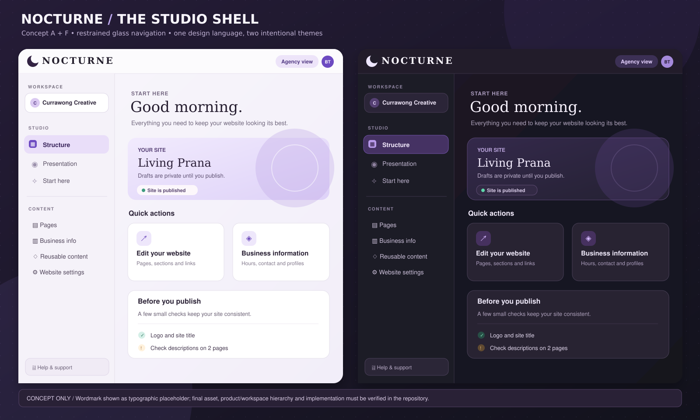
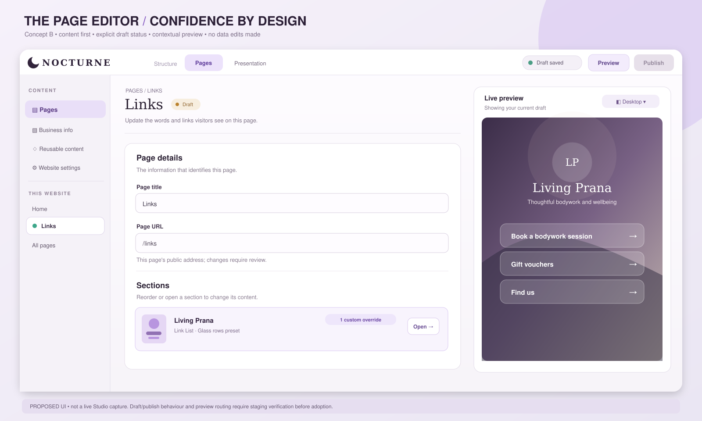
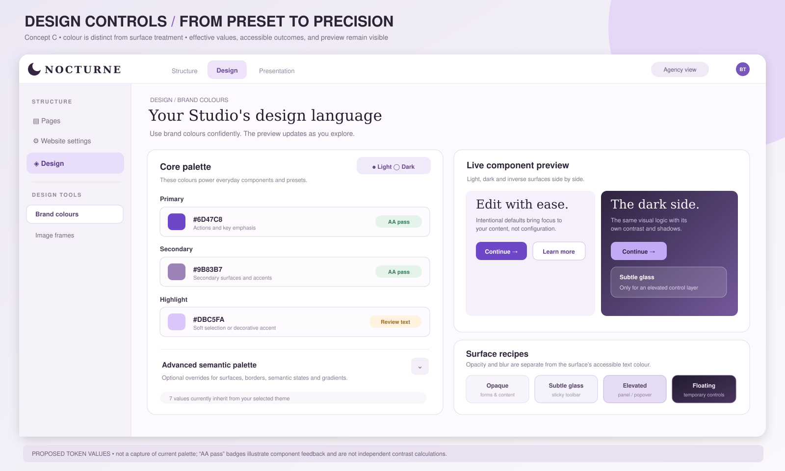
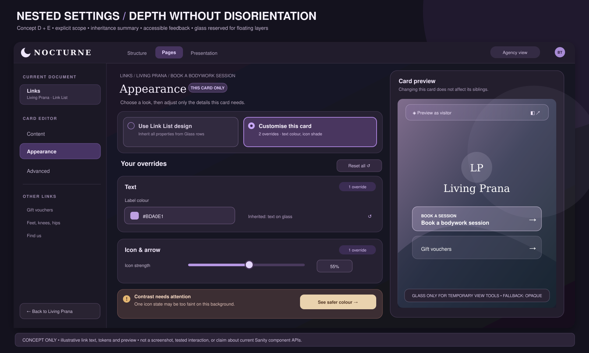

# Nocturne Studio — Premium Visual Redesign & Design System Proposal

**Concept specification v1 · 21 October 2026 (AEST)**  
**Status:** Design proposal, **not implemented**. No live website, Studio, configuration, code, content, or roadmap was changed.  
**Companion documents:** [Nocturne Studio — UI/UX & Product Quality Audit](Nocturne_Studio_UI_UX_Product_Quality_Audit.md) and [Nocturne — Claude Code Planning Handoff](Nocturne_Claude_Code_Planning_Handoff.md).

> **Creative direction: Quietly architectural.** A tactile, editorial-feeling creative tool: warm ivory and soft plum by day, ink and violet by night. Clean opaque editing surfaces do the hard work; restrained glass reveals layering on transient controls. The result should be recognisably Nocturne without fighting content or Sanity's familiar, reliable interaction model.

## 1. Evidence, starting point and design position

This expands a completed read-only Studio audit at `https://living-prana.vercel.app/studio/structure`. The existing audit covers the actual agency/client navigation, Start here, pages, Link List, Hero, nested card appearance, global settings, brand colours, Image frames, Presentation, Content health and ancillary tools. It recorded a **reproduced client-view Sections crash (UX-001)**, a **partially functional Presentation route-mapping warning (UX-002)**, and overly broad visual overrides (UX-003). Those reliability and workflow issues remain higher priority than cosmetic work.

### What the actual UI already gets right

- Warm-neutral surfaces, violet selected states, relatively restrained rounding and a branded-feeling shell—there is an existing visual seed to grow, not a blank slate.
- The **client/agency role split** is meaningful; client mode already hides Design, Advanced and developer-only launch operations. Protect it.
- Six **illustrated Link List presets** and a larger illustrated section picker communicate outcomes visually.
- **Brand colours** has an unusually useful live component preview, basic/advanced progression and contrast badges.
- Hero calls out when its fields diverge from a preset; cards can inherit or customise List design; breadcrumbs show nested levels.
- Form labels, image crop, alt guidance, validation and draft/publish separation offer important reassurance.

### What does not yet feel consistently premium

1. **Product identity is under-expressed in the shell.** At the inspected desktop size, the leading mark in the header was a small icon adjacent to a workspace switcher, not a legible horizontal Nocturne wordmark. The mark's exact asset/ownership was not inspected in source. The user also identified this as a high-priority visual issue. Product identity, agency/workspace identity, and client-site identity need deliberate hierarchy.
2. **The best visual design controls are concentrated in certain features.** Link List and Brand colours have richer previews and settings patterns than empty lists, technical tools and some generic document chrome. Visual consistency must apply to the whole Studio.
3. **Deep appearance editing is dense.** Many grouped controls are useful, but the effective preset/inheritance/override story is too difficult to see at a glance (UX-003).
4. **System states break the illusion of a crafted product.** A raw React error in client Sections (UX-001), unexplained Preview main-document warnings (UX-002), generic “No documents of this type,” and “Untitled” recent changes are not premium experiences.
5. **The shell has limited visual hierarchy between product, workspace and task.** The current top tools and left content lists work, but a stronger brand anchor and consistent page heading/toolbar rhythm would make it more recognisable and easier to scan.

**What is unverified:** actual Nocturne wordmark files/naming, current Studio/Sanity/React versions, token system, mode implementation, built-in component overrides, responsive/touch behaviour and full keyboard/screen-reader accessibility. The mockups below are **clearly conceptual**, not current screenshots. All hex values and dimensions are **proposed tokens**; no implementation compatibility is implied.

---

## 2. The visual north star

### Design principles

1. **Content before chrome.** Forms, rich text, tables and field labels remain solid, high contrast and quiet; brand identity frames the work rather than becoming the work.
2. **Layering has meaning.** A glass toolbar is floating; an opaque sheet is editable content; a selected pill means location or choice; a shadow communicates temporary elevation—not decoration.
3. **One visual grammar.** The same spacing, surface tiers, border radii, focus treatment, field/validation layout, and navigation states recur across tools.
4. **Premium comes from precision.** Better titles, baseline alignment, measured whitespace, predictable tab states and gentle feedback matter more than gradients everywhere.
5. **Two audiences, one product.** Client mode is an edited _view_ of the same design system, not an entirely separate app. Designer mode adds capability progressively.
6. **Respect Sanity.** The goal is maintainable theming and carefully scoped extensions; do not replace dependable native editing semantics just for stylistic uniformity.

### Identity system

- **Primary signature:** an authentic horizontal **Nocturne** wordmark (approved light/dark assets). Use its real artwork, not a stretched favicon or simulated text.
- **Secondary mark:** approved standalone icon for favicon, 64 px collapsed rail, small badges and places with insufficient width.
- **Studio accent:** controlled amethyst/violet; client brand palettes render only inside design settings and preview surfaces—not across the global admin shell.
- **Photography/texture:** generally avoid in editing chrome. Use restrained abstract aurora/ink washes only in welcome and preview scaffolding. Avoid visual noise behind data entry.
- **Typography personality:** a legible Sanity-compatible system sans for all functional UI; optional distinctive serif for a single welcome/display line only if its font loading, language coverage, brand suitability and performance are verified. No decorative font in forms, labels, navigation or numerical data.

---

## 3. Visual concepts — designed, not photographed

Each SVG is editable vector artwork; a PNG is provided for quick viewing. The design uses observed Nocturne task names and concepts but recomposes them as a **proposed future interface**. The **NOCTURNE** logotype and crescent in the concepts are **typographic placeholders, not verified brand assets**.

### Concept A + F — Studio shell, light and dark



[PNG preview](Nocturne_Concept_01_Studio_Shell_Light_Dark.png) · [Editable SVG](Nocturne_Concept_01_Studio_Shell_Light_Dark.svg)

**Shows:** horizontal wordmark on matching surface, separate workspace selector, slightly more intentional primary and contextual navigation, warm-ivory and ink-violet pair, restrained rounded selection, task-focused Start here, low-noise status cards. The shell uses predominantly opaque surfaces; glass should be optional on narrow floating/navigation layers, not its whole backdrop.

**Before → after:** small shell mark / diffuse hierarchy → obvious product identity and role/workspace hierarchy. Preserve current Start here tasks and role gating. Do not infer that all current screens use these exact layouts.

### Concept B — Page editor and content confidence



[PNG preview](Nocturne_Concept_02_Page_Editor.png) · [Editable SVG](Nocturne_Concept_02_Page_Editor.svg)

**Shows:** title and route near top, readable 44 px inputs, durable section row, a simple **“1 custom override”** indicator, and an adjacent draft preview with current publication states. This is a compositional recommendation, **not proof** that embedded preview or a particular autosave message already works. The client Sections crash must be fixed before this can be considered a successful flow.

### Concept C — Design tokens, presets and preview



[PNG preview](Nocturne_Concept_03_Design_Controls.png) · [Editable SVG](Nocturne_Concept_03_Design_Controls.svg)

**Shows:** a compact basic palette, advanced overrides collapsed, hex/swatch/usage together, component states in light/dark, and four surface recipes. The “AA pass” pills are **illustrative UI states only**, not independently validated metrics for the depicted combinations; actual contrast must be computed for each semantic usage.

### Concept D + E — Deeply nested appearance and restrained floating glass



[PNG preview](Nocturne_Concept_04_Nested_Glass_Editor.png) · [Editable SVG](Nocturne_Concept_04_Nested_Glass_Editor.svg)

**Shows:** an always-visible path and **“THIS CARD ONLY”** scope, parent return, inherited-vs-custom chooser, count of altered properties, per-group reset and a gentle warning with remediation. Glass is used on a **temporary preview toolbar**, while the main editor remains opaque. This deliberately preserves the capability currently present in Link List while reducing the amount that must be scanned.

### Before/after synthesis

| Existing observed pattern                                         | Proposed visual treatment                                                         | Why it improves the experience                                                                |
| ----------------------------------------------------------------- | --------------------------------------------------------------------------------- | --------------------------------------------------------------------------------------------- |
| Small icon near workspace name in shell                           | Authentic horizontal Nocturne lockup + separate workspace name                    | Establishes product identity and ownership without mistaking the client's brand for Nocturne. |
| Violet selected rows and branded neutral shell                    | Consistent 42 px selected row, 12 px radius, controlled accent + subtle tint      | Makes current good visual language deliberate across all tool lists.                          |
| Extensive Link List section/card controls                         | Short preset summary, 2–3 core groups, changed-only view, advanced disclosure     | Allows both fast default design and precise overrides.                                        |
| Generic native-looking fields intermixed with rich custom pickers | Unified field wrapper and spacing rhythm; native Sanity inputs remain where sound | Cohesion without fragile wholesale component replacement.                                     |
| Excellent Brand colours preview                                   | Generalised _effective value + preview + diagnostic_ design-control primitive     | Scales the strongest existing pattern across sections.                                        |
| Raw error and generic empty lists                                 | Calm contextual state components with a single safe next action                   | Restores trust during non-happy paths.                                                        |
| Presentation main-document warning                                | Clear route/document state and intentional empty/redirect messaging               | Reinforces that what users see is what they are editing.                                      |

---

## 4. Wordmark and product/workspace architecture — VD-001

**Current evidence:** At desktop width, the Studio header displayed a small brand-like icon and “Currawong Creative” workspace text. The UI did not present a prominent, legible horizontal Nocturne wordmark in the inspected main shell. **Do not assume that visible icon is Nocturne's actual asset**, or that the file names mentioned in the brief exist.

### Asset inventory and selection procedure

Claude Code should inspect, without altering, actual design assets, `public/`, imports, any site/Studio logo configuration, Sanity workspace config and existing `wordmark-on-light`, `wordmark-on-dark`, standalone icon and favicon if present. Record real paths, formats, dimensions, licensing/source and usage. If absent, **request approved artwork**; do not generate or rename an imitation as the final corporate mark.

**Variant choice is based on the surface behind it**:

| Surface behind mark                      | Render choice                                                                  | Verify                                                           |
| ---------------------------------------- | ------------------------------------------------------------------------------ | ---------------------------------------------------------------- |
| Light/ivory opaque header                | Dark-ink wordmark artwork                                                      | Visible logo-to-surface contrast and correct transparent padding |
| Dark/ink navigation/header               | Light-ivory wordmark artwork                                                   | No inverted background box; crisp edges                          |
| Glass toolbar over variable imagery      | Prefer an opaque local logo plate or guaranteed scrim; then choose accordingly | Contrast under worst-case sampled backgrounds                    |
| Collapsed 64 px rail / tiny mobile shell | Standalone icon only with accessible product name nearby or tooltip            | Recognition, focus/name, 24–28 px symbol                         |
| Browser tab                              | Favicon                                                                        | Sizes and platform metadata                                      |

Do **not** choose a `*-on-light` file by name alone: some libraries name exports by ink colour and others by intended background. Inspect raster/vector contents on both actual backgrounds. Don't rely only on global `prefers-color-scheme`: a dark navigation surface inside a light theme still gets the light artwork.

### Proposed logo component and dimensions

| Context                             | Proposed sizing                                                                        | Clear space/alignment                                                                                                        |
| ----------------------------------- | -------------------------------------------------------------------------------------- | ---------------------------------------------------------------------------------------------------------------------------- |
| Desktop header (≥1024 px shell)     | Artwork box **154–178 px wide, 24–30 px high**, `object-fit: contain`, never stretched | At least **12 px** free space around visual artwork; left aligned to 20–24 px shell padding; optically centred in ~60 px bar |
| Tablet/compact header (768–1023 px) | **122–150 px × 22–26 px** if room remains                                              | Preserve minimum 8 px from neighbouring hit targets                                                                          |
| Collapsed rail / narrow phone       | Approved icon **24–28 px** inside ≥44 px hit/context area                              | Accessible label “Nocturne Studio”; tooltip when appropriate; never tiny 12–16 px faux wordmark                              |
| Welcome / authentication            | **176–220 px × natural aspect** with intentional breathing room                        | Does not supersede client/site identity in Preview                                                                           |

Optimise actual SVG paths and viewBox, or ship 2×/3× responsive PNG where SVG is unavailable. Specify width/height to avoid layout shift. Test light/dark, nested/compact headers and keyboard focus. A purely decorative adjacent crescent gets empty alt; the one semantic brand image can use `alt="Nocturne Studio"`, avoiding redundant spoken names.

**Sanity feasibility:** a workspace `icon` is supported for small identity marks; current official Sanity docs explain that a former `logo` override is deprecated. A wordmark in the shell may call for a **supported navbar composition or wrapper** rather than a deprecated logo hook. Verify actual installed version and current custom navbar behaviour first. [Sanity Studio components](https://www.sanity.io/docs/studio/studio-components) · [Components reference](https://www.sanity.io/docs/studio/studio-components-reference).

**Acceptance:** A correct approved asset appears legibly in every tested header surface; maintains aspect and clear space; switches on actual surface colour; no favicon inflation; desktop/compact layouts pass visual tests; no loss of workspace switcher, tools, focus or accessibility.

---

## 5. Studio light/dark semantic colour system — VD-002

This is **Nocturne's administration UI** palette. It must **not** be sourced directly from the active client's website brand tokens. Site brand colours belong inside visual editor previews and that site's Design settings.

### Proposed semantic foundation

| Token                  | Light proposal | Dark proposal | Usage / caution                                                      |
| ---------------------- | -------------- | ------------- | -------------------------------------------------------------------- |
| `studio.canvas`        | `#F7F4FA`      | `#17151F`     | Background outside primary content sheets                            |
| `studio.nav`           | `#F5F2F8`      | `#1D1A27`     | Left rail; mostly opaque                                             |
| `studio.surface`       | `#FFFEFF`      | `#25212F`     | Main editable sheets, form bodies                                    |
| `studio.surfaceRaised` | `#FFFFFF`      | `#2B2638`     | Popover/dialog base; avoid transparent text input                    |
| `studio.text`          | `#1F1A29`      | `#F6F3FA`     | Primary copy                                                         |
| `studio.textMuted`     | `#635B70`      | `#B9B1C9`     | Helpers and subdued chrome; check at small sizes                     |
| `studio.border`        | `#DED8E8`      | `#4B415A`     | Normal structure; test against neighbours                            |
| `studio.borderStrong`  | `#BFB2CF`      | `#71617F`     | Interactive boundary, separator where needed                         |
| `studio.accent`        | `#6D47C8`      | `#C4A9F6`     | Primary controls, focus/selected cue; validate use-specific contrast |
| `studio.onAccent`      | `#FFFFFF`      | `#211E2B`     | Text on the accent button                                            |
| `studio.selectionBg`   | `#ECE2FA`      | `#46345F`     | Selected nav rows, distinct from hover                               |
| `studio.focus`         | `#7651DC`      | `#D2B6FF`     | 2 px focus outline + 2 px offset; against surrounding surface        |
| `studio.success`       | `#257E66`      | `#7CE1BB`     | Pair symbol/message, not green alone                                 |
| `studio.warning`       | `#9C621A`      | `#F1C57F`     | Warnings and attention; not default orange outlines                  |
| `studio.error`         | `#B83D53`      | `#FF9BA9`     | Errors and destructive consequences                                  |

**Sample computed solid-surface contrast ratios (WCAG luminance formula, not a certified audit):** `#1F1A29` on `#FAF8FC` ≈ **16.1:1**; `#635B70` on `#FAF8FC` ≈ **6.1:1**; white on light accent `#6D47C8` ≈ **6.2:1**; `#F6F3FA` on dark `#211E2B` ≈ **14.9:1**; `#B9B1C9` on `#211E2B` ≈ **7.9:1**; dark ink on dark accent `#C4A9F6` ≈ **8.1:1**. **Recompute on actual blended/glass/background states and rendered text sizes.** White text on secondary `#9B83B7` is only about **3.3:1**, so treat that colour as decorative/background, not a universal text button.

### Theme design rules

- Design dark mode deliberately; do not simply invert light CSS colours. Dark surfaces should be separated by _modest luminance and border shifts_, not huge shadows.
- Primary text remains crisp. Helpers should not fade under ~4.5:1 when normal-sized. Disabled status is supplemented with semantic text or tooltip, not opacity alone.
- Always determine selected styling by role/state, not arbitrary brand inheritance.
- Keep colour decisions in semantic tokens rather than hardcoding each component. Map proposals to actual Sanity theme slots after inspecting installed version.
- Wordmark variant is determined by the actual header plate's surface colour, independently of the site preview's theme.

---

## 6. Restrained glass surface recipes — VD-003

**Glass is a surface/geometry effect. Colour is a separate semantic layer.** A glass token describes translucency, blur and edge, while text/icon/button colours come from the surface context and contrast tests. This avoids coupling a stylistic effect to one brand purple.

| Recipe                        | Proposed treatment (light / dark)                                                                                  | Best placement                                                                        | Do **not** use                                                            |
| ----------------------------- | ------------------------------------------------------------------------------------------------------------------ | ------------------------------------------------------------------------------------- | ------------------------------------------------------------------------- |
| **Opaque** `surface.opaque`   | Alpha **1.0**, no blur, semantic `surface`                                                                         | Editors, form fields, lists, long copy, data tables, accessibility-sensitive controls | None; default safe tier                                                   |
| **Subtle** `glass.subtle`     | ~`rgba(255,254,255,.88)` / `rgba(37,33,47,.90)`; **8–10 px** blur; 1 px low-contrast border; faint inner highlight | Sticky non-editable header, secondary toolbar over known uniform surface              | Over busy photos without a stable scrim; every card in a long scroll list |
| **Elevated** `glass.elevated` | ~`.93` / `.94` alpha; **12–16 px** blur, subtle border + small shadow                                              | Short popovers, floating pickers, context menus                                       | Long multi-field dialogs or text editing canvases                         |
| **Floating** `glass.floating` | ~`.82–.88` alpha; **16–18 px** blur; slightly stronger edge + elevation                                            | Short Preview toolbars, temporary inspector overlay                                   | Full-width permanent sidebar; large image/video area; dense input panels  |

**Rendering/interaction constraints:**

1. Put blur on a _small bounded layer_ with stable height/width, never on an entire scrolling editor or every list item. Avoid nested backdrop filters and expensive large-radius blur.
2. Recalculate readable foreground on the **worst plausible background**. On variable photo preview, use an opaque text plate or guaranteed tint/scrim; a glass border alone cannot guarantee contrast.
3. On unsupported `backdrop-filter`, reduced transparency preferences where available, high contrast/forced colours, or degraded performance, fall back to a **fully opaque** matching surface. Preserve the same border, size and hit target.
4. Reduced-motion users get no decorative slide/blur animation; glass itself should never require animation to be legible.
5. Glass is never the validation state. Warnings, destructive actions and focus indicators must remain explicitly visible independent of blur.

### Example token shape (conceptual, not verified code)

```css
/* Illustrative Nocturne-owned UI layer; exact Sanity integration TBD. */
.nocturne-floating-toolbar {
  background: var(--n-glass-floating-fill);
  border: 1px solid var(--n-glass-floating-stroke);
  box-shadow: var(--n-shadow-floating);
  backdrop-filter: blur(16px);
  -webkit-backdrop-filter: blur(16px);
}
@supports not (backdrop-filter: blur(1px)) {
  .nocturne-floating-toolbar {
    background: var(--n-surface-raised);
  }
}
@media (prefers-reduced-transparency: reduce), (forced-colors: active) {
  .nocturne-floating-toolbar {
    backdrop-filter: none;
    -webkit-backdrop-filter: none;
    background: var(--n-surface-raised);
  }
}
```

Browser support for `prefers-reduced-transparency` is not universal; treat it as an enhancement and always keep an application/user fallback for high-contrast mode. A colour contrast audit is required even with high alpha.

---

## 7. Component language — dimensions and behaviour

The following are **target proposals**, not measurements of existing components. Preserve accessible Sanity UI components when they already satisfy the intent; customise wrappers/layout first. Use one 4 px base scale. **Height** and **radius** are not interchangeable: rounded does not mean pill-shaped by default.

### Buttons — VD-004

| Variant        | Height / padding / radius                                                            | Fill/border                                                        | State & usage                                                   |
| -------------- | ------------------------------------------------------------------------------------ | ------------------------------------------------------------------ | --------------------------------------------------------------- |
| Primary action | **40–44 px**, 16 px x padding, **11–12 px** radius, 14 px/600                        | Semantic accent and on-accent text                                 | Publish/Continue/major save; single dominant action in a region |
| Secondary      | **40 px**, 14–16 px x padding, **11 px**                                             | Opaque raised surface, 1 px strong boundary                        | Preview, Cancel, choose media                                   |
| Tertiary/ghost | **36–40 px**, 12 px x, **10 px**                                                     | No heavy box at rest; gentle fill on hover                         | Open, move, reveal, low-priority controls                       |
| Destructive    | **40–44 px**, 14–16 px x, **11 px**                                                  | Explicit danger emphasis; confirmation for destructive persistence | Delete/reset data, **never** accidental recovery fallback       |
| Icon-only      | **40 × 40 px** visually, ≥44 px comfortable pointer target when practical, **10 px** | Subtle surface and tooltip                                         | Close, contextual actions, rearrange; accessible name required  |
| Compact pill   | **28–32 px**, full-pill radius                                                       | Low-emphasis semantic tint                                         | Status, role, inheritance count; not every button               |

**States:** hover tint/border change within 120–160 ms; pressed translates ~1 px or darkens without layout change; keyboard `:focus-visible` has a 2 px contrast-tested ring with offset; loading locks duplicate submissions and keeps label/width stable; disabled uses explanatory text and no action; success reports outcome outside colour only. Button labels are action verbs, not technical object names.

**Observed opportunity:** native Sanity buttons, custom compact controls, titlebar version buttons and Link List change/reset affordances should share intent and hierarchy. Avoid replacing all native buttons if a theme token can do the work.

### Inputs, labels and field blocks — VD-005

- Text, number, URL, search and select input: **44 px minimum control height**, 10 px radius, 1 px border, 12–14 px horizontal inset; 14 px/20–22 line-height content. Multiline textarea: minimum **104 px**, 12 px vertical inset, resize appropriate to field.
- Label: **13 px / 18**, semibold, primary text. Helper: **12–13 px / 18–19**, readable muted text; one idea per line. Required/optional indicators use consistent text.
- Field rhythm: **6 px** label-to-control, **6–8 px** control-to-helper, **16–20 px** next field gap, **24–32 px** between functional groups.
- Focus: 2 px external ring + 2 px offset, not just border hue. Hover border stronger but not equal to focus. Error: border + icon + direct message and route to fix, preserving entered value.
- Do not encode validation as placeholder text. Use real labels and stable layout. URL controls show route/destination consequences without technical jargon.
- Search: clear action with accessible name, useful empty search result state; no elaborate picker where plain text input suffices.

**Observed opportunity:** the Link card destination, Page URL, brand colour hex fields and general metadata editing are the primary consistency sample set.

### Toggles, checkboxes, radios, segments — VD-006

| Control            | Proposed dimensions                                          | Behaviour                                                                                              |
| ------------------ | ------------------------------------------------------------ | ------------------------------------------------------------------------------------------------------ |
| Switch             | Track **40 × 24 px**, thumb ~18 px                           | For immediate binary feature/on-off, text label and meaningful on/off copy; disabled distinct from off |
| Checkbox           | Box **18–20 px**, 6 px radius                                | Multi-select or independent options; label row ≥40 px tall                                             |
| Radio              | Dot **18–20 px**                                             | Mutually exclusive options; full illustrated preset card is keyboard-selectable radio semantic         |
| Segmented selector | 36–40 px tall, radius 10–11                                  | Only ~2–4 short options like Light/Dark, not long lists                                                |
| Preset card        | ≥**136 × 100 px** thumbnail plus label/help; 12–14 px radius | Entire tile hit area, text+illustration selected cue, arrow key/tab behaviour verified                 |

Keep Link List's **six illustrated presets**. For long section catalogues, group lightly by task and preserve search. Inheritance is a separate choice: “Use Link List design” versus “Customise this card,” with a readable summary of effective values.

### Sliders and precise controls — VD-007

Slider track **6 px**, thumb **18–20 px**, visible numeric readout within **66–84 px** wide input; allow exact keyboard edits, step labels, valid min/max and unit (px, %, rem, opacity) beside value. Provide direct reset-to-inherited affordance; show its source and current effective value. Avoid a slider alone for high-precision border thickness or opacity when typed input is more predictable. Do not reveal dozens of sliders by default.

### Cards, panels and accordions — VD-008

- Content cards: radius **14–16 px**, padding **20–24 px**, normal 1 px semantic border, no always-on heavy shadow.
- Nested panel: radius **16–18 px**, padding **24 px desktop / 16–20 px narrow**, with sticky title/path if scroll is long.
- Accordion: whole row height **44–48 px**, title 14–15 px/600, right chevron, short effective-state summary and consistent open state. Preserve focus and scroll on expand/collapse.
- Document list rows: minimum **42 px** and stable icon/title/meta columns. Selected style uses tint and text weight, not only a 1 px colour accent.
- Empty states: one purpose line, one reason if needed, and one valid action; no generic “No documents of this type” when a collection has a clear business meaning (see UX-005).

### Tabs, navigation, and shell — VD-009

- Top shell bar: target **60–64 px**. The product wordmark occupies a stable ~210 px brand zone; workspace selector and tool navigation remain distinguishable.
- Left navigation: target **224–248 px** expanded, **60–68 px** compact. Route/tool hierarchy must survive tablet constraints. Avoid relying solely on collapsed icons without tooltips/labels.
- Nav item: **40–44 px** high, 10–12 px radius, 12–16 px inset; consistent hover/selected/focus. One active primary tool and one contextual list selection may coexist but use distinct treatments.
- Tab row: **40–44 px** high; active state via text weight and persistent line/tint, not translucency alone. Use standard Sanity tabs when possible.
- Breadcrumb: readable full current scope on desktop; collapsible ancestors with accessible menu in narrow viewport. Include an explicit **“Back to [parent]”** action in deep nested panels, not only an X.
- Content width: favour a comfortable **640–800 px main form column** plus optional **340–460 px** Preview/inspector when screen permits. Prevent 3–4 cramped scroll panes at smaller widths; at narrow tablet, Preview becomes a toggled pane and form takes width.
- Titles and status appear together near the top: object name, route, draft/published state, and where the edit applies. Keep publication actions predictable in one place.

### Dialogs, popovers, menus — VD-010

- Popover/picker: radius **14 px**, 12–16 px padding, elevated surface and modest shadow. Use a simple select for a small set of nonvisual values.
- Short confirmation dialog: max width **420–480 px**, radius **20 px**, padding **24 px**. Confirmation language specifies what is affected and what can be undone.
- Large rich picker: max **800–920 px**, responsive grid; named sections, search and illustrated choices. Avoid forcing a large modal for a short action.
- Deep nested editing is better as a clear panel/drawer with breadcrumbs than a stack of unrelated modals. A close action and a back-to-parent action have **different semantics**.
- Escape closes temporary popovers, restores focus and never discards a saved value unexpectedly; trap focus only inside true modals. Warn before irreversible destructive change.

### Iconography — VD-011

Standard visual sizes **16 / 18 / 20 / 24 px** with consistent existing library/stroke approach (~1.75–2 px if custom line icons). Avoid mixing pictograms, generic emoji and mismatched stroke weights in production controls. Keep symbols optical-centred within their button, not baseline-aligned to text. Every icon-only action needs accessible name and tooltip. A chevron means expand/next, X means dismiss/close, arrow-left means back; preserve consistent semantics in nested work.

---

## 8. Spatial, typography and elevation tokens — VD-012

| Family      | Proposed scale                        | Applied rule                                                                           |
| ----------- | ------------------------------------- | -------------------------------------------------------------------------------------- |
| Spacing     | `4, 8, 12, 16, 20, 24, 32, 40, 48` px | Base rhythm. Avoid arbitrary 17/23/27 px gaps in related components.                   |
| Corners     | `6, 8, 10, 12, 16, 20, 999` px        | 10 input, 11–12 button, 12 nav/preset, 16 card, 20 dialog, 999 status pill             |
| Type XS     | **12 / 18**                           | Meta, helper, breadcrumbs where contrast permits; don't compress critical instructions |
| Type S      | **13 / 19**                           | Field labels, compact list details                                                     |
| Type M      | **14 / 21**                           | Main body and inputs; consistent with Sanity UI font where practical                   |
| Type L      | **16 / 24**                           | Group title and sidebar heading                                                        |
| Type XL     | **20 / 28**                           | Document section title                                                                 |
| Display     | **28–32 / 36–40**                     | Top document and Start here headline; optional editorial face only here                |
| Weight      | **400 / 500 / 600 / 700**             | Reserve 700 for strong title/primary action. No all-caps helper walls.                 |
| Elevation 0 | 0 shadow + hairline border            | Inputs, long content panels                                                            |
| Elevation 1 | `0 2px 8px rgba(25,17,37,.06)`        | Hovered/pinned cards                                                                   |
| Elevation 2 | `0 10px 28px rgba(25,17,37,.13)`      | Popover/floating controls                                                              |
| Elevation 3 | `0 24px 64px rgba(15,11,25,.24)`      | True modal only, with backdrop                                                         |

For dark mode, reduce reliance on shadows and use stronger _surface/border separation_ instead. Line lengths in help copy should generally be comfortable (~45–75 characters where layout permits). Inputs and actionable text should never fall below readable size to fit an excessive number of columns.

### Motion and feedback

- Hover/focus: colour/border shift **120–160 ms** ease-out; avoid scale bounces on forms.
- Dialog enter: fade/translate **140–180 ms**; reduce-motion: immediate transition. No elaborate scroll/parallax.
- Skeletons: quiet, low-contrast blocks for navigation delays; avoid perpetual shimmer where it distracts.
- Save state: “Saving… → Draft saved” only when it reflects actual persisted behaviour; error maintains draft and offers retry/context. Publication status is distinct.
- Selected preview/content mapping should highlight the exact section but should not jump the page unexpectedly.
- Destructive controls: clear intent, confirmation and reversibility. A framework error must not offer ambiguous “Unset value” as primary recovery.

---

## 9. System states and accessible recovery — VD-013

| State                | Proposed appearance + words                                                        | Validation                                                                   |
| -------------------- | ---------------------------------------------------------------------------------- | ---------------------------------------------------------------------------- |
| Empty collection     | Relevant illustration only if useful; short purpose; permission-valid CTA          | Forms vs Panels vs Enquiries have different messages; no dead action         |
| Empty search         | “No matching [items]. Try another search.” + clear action                          | Does not imply missing data or permission failure                            |
| Loading              | Stable sheet size, skeleton/spinner with meaningful accessible status              | No repeated layout shift or auto-scroll                                      |
| Saving               | “Saving draft…” at document toolbar; retain controls as appropriate                | Debounce/network verified; no fabricated success                             |
| Saved                | “Draft saved” with time/status where meaningful                                    | Draft remains unpublished; assistive announcement not overly repetitive      |
| Publish available    | Clear primary button and “This makes changes live” context                         | Role/permissions and version state verified in staging                       |
| Error                | Human explanation, retry, diagnostic reference and support route; preserve content | Client Sections crash regression; no raw React trace or destructive fallback |
| Warning              | Amber/orange with icon + exact affected value + safe suggestion                    | Contrast and invalid SVG warnings deep-link to a field                       |
| Success              | Brief confirmation, undo where supported                                           | No unsupported promise of rollback                                           |
| Disabled/unavailable | Readable explanation, distinct from off/unselected                                 | Keyboard names/ARIA state and contrast checked                               |
| Focus/hover/pressed  | Semantic ring, tint and active feedback                                            | Keyboard/mouse/touch equivalent, with hit areas                              |

Accessibility and responsiveness are **design gates**, not optional polish. Test actual computed contrast in light/dark, image/glass/hover, small text, keyboard path, visual focus, reduced motion/transparency, zoom to 200–400%, screen reader names, and narrow/touch. The earlier audit **did not certify WCAG compliance**; UI contrast warnings show specific potential issues only. Use a known accessible component library as the starting point, not as a substitute for product-level verification.

---

## 10. Detailed before/after implementation cards

Each row is a _candidate task_, not a confirmed repository task or a command to implement now. Effort is preliminary. “T” denotes a theme/token-oriented change, “C” a custom component or wrapper, “A” architectural/workflow work, and “?” requires version feasibility investigation.

| ID         | Current UI evidence and pain                                                                               | Specific after-state                                                                        | Reach / feasibility              | Risk and acceptance test                                                      |
| ---------- | ---------------------------------------------------------------------------------------------------------- | ------------------------------------------------------------------------------------------- | -------------------------------- | ----------------------------------------------------------------------------- |
| **VD-001** | Small icon and workspace name dominate product identity in top shell                                       | Authentic wordmark component 154–178 px desktop, surface-aware asset, compact icon fallback | All tools; **C / ?**             | No layout shift, no Sanity navbar break, correct contrast and semantics       |
| **VD-002** | Neutral/violet identity exists but lacks audited shared semantic system                                    | Light/dark surface, text, border, accent, focus, semantic status palette above              | All surfaces; **T / ?**          | Snapshot major screens and contrast combinations; client themes remain scoped |
| **VD-003** | Glass currently appears prominently in Link List _site content_, not as a consistent Studio surface recipe | Four controlled surface recipes, only temporary layers blurred                              | Custom toolbar/panels; **C / ?** | Real blur fallback and performance; no unreadable text over images            |
| **VD-004** | Native/custom/button bar affordances vary in emphasis                                                      | 40–44 px primary/secondary, quiet ghost, explicit destructive, 44 px hit targets            | Broad; **T + C**                 | Native actions remain keyboard/AT compatible; states differentiated           |
| **VD-005** | Field-level help good, but density/shape may vary across plugins and custom inputs                         | 44 px input, consistent wrapper/label/help/error, robust focus                              | Cross-editor; **T + C**          | Long text, validation, schema changes and Sanity upgrades unaffected          |
| **VD-006** | Six illustrated Link List presets good; other selectors vary                                               | Standard preset tile, radio/switch/segment semantics and state tokens                       | Shared design controls; **C**    | Search, arrow keys, roles, touch, selected/read-only states pass              |
| **VD-007** | Custom appearance includes multiple precision options with inherited layers                                | Numeric slider, inherited value/source label and single reset                               | Advanced appearance; **C + A**   | Doesn't change saved values/sibling styles unexpectedly                       |
| **VD-008** | Document cards, groups and empty lists differ in contextual richness                                       | 16 px cards, 24 px group padding, effective-value summaries and tailored empties            | Many screens; **T + C**          | No giant forms or scroll traps; preserve native list performance              |
| **VD-009** | Tool rail, pages, nested editors and Preview have complex parallel hierarchies                             | 60 px top bar, 224–248 px rail, scoped breadcrumb, adaptive two-column form/preview         | Shell/navigation; **C + A / ?**  | Mobile layout, role gating and focus restoration; no more trapped panels      |
| **VD-010** | Colour crop/dialogs, section picker and nested modals use different densities                              | Radius 14 popover / 20 dialog, appropriate size and focus rules                             | Inputs/pickers; **T + C**        | Avoid replacing native dialog semantics without verified need                 |
| **VD-011** | Compact icon actions sometimes unclear in visual/tree sampling                                             | Shared 16/18/20/24 icon scale, labels, consistent hit areas                                 | Toolbars/forms; **T + C**        | Manual keyboard/AT review; do not infer blanket failure beforehand            |
| **VD-012** | Existing good spacing needs systematisation                                                                | 4 px spacing base, limited radii/elevation/type sizes and restrained motion                 | All new UI; **T**                | Prevent CSS cascade/regression across plugin variants                         |
| **VD-013** | React error, preview warning, generic empties, contrast/asset warnings                                     | Coherent non-happy-path feedback components and safe recovery                               | Cross-app; **C + A**             | UX-001/002 correctness takes precedence over styling an error                 |

### Implementation boundaries

- **Do not count observed strengths as missing:** Brand colours already has live previews and diagnostics; Link List already has illustrated preset cards, inheritance and an extensive designer mode; the client/agency role filter already works meaningfully.
- **Do not roll out every advanced Link List control globally.** First research shared functional needs and set component adoption criteria.
- **Do not apply a Studio surface/glass style to client website output.** Preview should reflect that site's design independently.
- **Do not use the mockup's typography or status labels as proof of current support.** They are goals subject to staged UX testing.

---

## 11. Sanity compatibility and feasibility research

Official Sanity docs current at this audit date describe **supported Studio theming**, `studio.components` overrides (`navbar`, `toolMenu`, `layout`, `activeToolLayout`), `form.components` hooks, and `@sanity/ui` primitives. They encourage custom inputs for specialised interactions but note that content updates must use Sanity's normal patch/change semantics. Relevant primary sources:

1. [Sanity — Studio customization](https://www.sanity.io/docs/studio/studio-customization)
2. [Sanity — Theming Sanity Studio](https://www.sanity.io/docs/studio/theming)
3. [Sanity — Studio components reference](https://www.sanity.io/docs/studio/studio-components-reference)
4. [Sanity — Custom components](https://www.sanity.io/docs/studio/intro-to-custom-studio-components)

**Critical version caveat:** the official 2026 theming docs describe `@sanity/themer` as requiring **Studio 6+ and React 19**; earlier Studio/React combinations need their own compatible path. The preview `themerTool` is marked experimental/alpha; the production `buildTheme` API is the stable proposed route on compatible versions. `buildLegacyTheme` and legacy logo hooks are deprecated. **Nocturne's installed versions were not inspected.** Do not blindly paste the latest example into the repository.

### Feasibility tiers

| Tier                                    | Likely approach                                                                                                             | Appropriate candidates                                                    | Version check needed                                                     |
| --------------------------------------- | --------------------------------------------------------------------------------------------------------------------------- | ------------------------------------------------------------------------- | ------------------------------------------------------------------------ |
| **1 — Supported theme**                 | Studio theme palette / `@sanity/ui` scale, typography within supported APIs                                                 | Semantic light/dark colours, focus tone, many native UI surfaces          | Installed `sanity`, `@sanity/ui`, React and theme config                 |
| **2 — Small supported extension**       | Render default navbar/tool menu with injected brand component; custom form wrappers/input components; Sanity UI composables | Wordmark, purposeful status card, Help/empty states, preset tile wrappers | `studio.components`, `form.components` signatures, current custom config |
| **3 — Architectural interaction work**  | Effective style computation, preset inheritance metadata, parent-scope navigation, draft preview resolver                   | UX-002/003/011, VD-007/009/013                                            | Content schemas, existing migrations, tests, data safety                 |
| **4 — Potentially unsupported/brittle** | Blanket DOM selectors against internal Sanity markup, wholesale native layout replacement, undocumented style injection     | Avoid as default                                                          | Sanity upgrade risk and API stability assessment                         |

**Discovery questions for Claude Code (planning pass only):**

1. What exact Sanity/React/`@sanity/ui` versions and theme APIs does Nocturne use today? Is Studio 6 applicable?
2. What workspace/nav overrides already exist? Is there a renderDefault-compatible place for a genuine wordmark without suppressing workspace/action affordances?
3. Where are existing logo files, what do “on-light/on-dark” mean in _actual pixels_, and are they suitable at horizontal header sizes?
4. Is there a semantic token package now? Which custom components share tokens and which hardcode colours/radii?
5. What is the current client/agency mode boundary, and do theme changes apply consistently without exposing hidden tools?
6. Are Link List inheritance and overrides represented in schema, runtime defaults or transient UI? What migration/reconciliation risks exist?
7. What native Sanity primitives can be themed rather than cloned? What places need a custom `@sanity/ui` component?
8. Are Preview root redirects, routes and editor association implemented in a way a new visual panel would break?
9. Which accessibility, dark-mode, responsive visual regression, e2e and performance tests are already configured?
10. Which release/milestone should own this work based on the **actual plan**, not an invented version?

---

## 12. Designer/client view strategy

Keep a coherent shell and interaction language for both roles. Vary **capability exposure**, not component polish.

| Layer                       | Client default                                                | Agency designer                                            | Design effect                                                |
| --------------------------- | ------------------------------------------------------------- | ---------------------------------------------------------- | ------------------------------------------------------------ |
| **Content**                 | Text, images, links, safe visibility, hours                   | All authoring controls                                     | Mostly opaque, roomy, reassuring forms                       |
| **Presets**                 | Approved layouts/section styles when permissioned             | Full curated library with preview                          | Illustrated cards + effective result summary                 |
| **Advanced**                | Hidden or read-only if unsuitable                             | Per-property colours, type, spacing, effects and overrides | Collapsed changed-only view with clear inheritance and reset |
| **Global site design**      | Only client-appropriate settings                              | Brand tokens, image frames, design assets                  | Same design-system visuals, role-gated location              |
| **Platform administration** | Suppress technical CLI/PR and paid/unused tools unless useful | Diagnostic, AI, health, redirects, tools                   | No second confusing branded product                          |

This extends an already strong role split. Test permissions separately from the client's preview-mode toggle; role-specific visibility is **not itself** proof of enforcement.

---

## 13. Responsive, accessibility and performance acceptance matrix

| Context                     | Layout target                                                                 | Test gate                                                               |
| --------------------------- | ----------------------------------------------------------------------------- | ----------------------------------------------------------------------- |
| ≥1440 px desktop            | 240 px rail, 640–800 px form, preview/inspector in remaining area             | No needless four-column cramp; heading and status visible               |
| 1024–1439 px laptop         | Rail can reduce, inspector toggles or narrows                                 | Forms ≥560 px if practical, no horizontal overflow                      |
| 768–1023 px tablet          | Compact rail and switchable edit/preview panes                                | Touch targets, scroll/focus, title/breadcrumb controls remain reachable |
| 360–767 px phone            | Single main column, icon/compact brand, sticky safe actions only where needed | No trapped nested dialog; 200% zoom and virtual keyboard support        |
| Light/dark/forced colours   | Distinct semantic token sets and opaque accessibility fallback                | Contrast, focus, errors, wordmark surface matching                      |
| Reduced motion/transparency | No decorative transitions/blur dependency                                     | All controls still legible and actionable                               |
| Keyboard + screen reader    | Native roles, names, popover/dialog management                                | End-to-end from page list to nested card and back                       |
| Slower CPU/mobile           | No large blur areas or perpetual shimmer                                      | Measured route/editor response; no degraded typing latency              |

Treat the mockups as a design target. **Actual breakpoints and performance thresholds must be chosen after measuring the implemented shell and target devices**, not copied unquestioningly from these suggested ranges.

---

## 14. Prioritised delivery sequence

| Sequence                   | Package                                                                                | Candidate IDs                                      | Why now                                                 | Exit gate                                                              |
| -------------------------- | -------------------------------------------------------------------------------------- | -------------------------------------------------- | ------------------------------------------------------- | ---------------------------------------------------------------------- |
| **0 — Stability first**    | Fix client page Sections and Preview mapping before broad rollout                      | **UX-001**, UX-002                                 | Core trust cannot be styled into correctness            | Client edits sections without crash; Preview mapping explained/correct |
| **1 — Foundation**         | Wordmark asset/component, colour semantics, type/space/radii, interaction/focus tokens | **VD-001, VD-002, VD-012**, part VD-004            | Largest consistent visual lift across all screens       | Light/dark shell and controls sampled; no native regressions           |
| **2 — Shared UI polish**   | Buttons/forms, card/panel/empty states, menus, icons, modest glass                     | **VD-003–006, VD-008, VD-010/011**, UX-005/007/008 | Cohesive language for high-frequency tasks              | Shared tokens/components adopted on three representative screens       |
| **3 — Workflow clarity**   | Nested scope, inheritance summaries, preview/publish confidence, guided roles          | **UX-003/011/015**, VD-007/009/013                 | Improves predictability beyond appearance               | User tests answer who/what changes, safe reset and preview             |
| **4 — Component adoption** | Link List / Hero / Brand colours / Image frames / new sections                         | UX-004/009/010/016 and appropriate VD work         | Spread a proven system without duplicating capabilities | Adoption matrix with screenshots/tests per component                   |
| **5 — Later enhancement**  | Richer motion, optional bespoke panels, deeper personalisation                         | Investigate only after usage/performance evidence  | Avoid feature-driven clutter                            | Product, accessibility and maintainability review                      |

**Not all items are engineering tasks.** Actual approval, asset design/brand choice, UX validation and client-site data quality may have separate owners. This table is not an invented official version plan. Claude Code must map it to real milestones and preserve historical IDs/statuses.

### Component adoption matrix template

| Component / screen           | Theme tokens | Wordmark/nav | Forms/states     | Presets/inheritance     | Contrast/QA                 | Status evidence       |
| ---------------------------- | ------------ | ------------ | ---------------- | ----------------------- | --------------------------- | --------------------- |
| Studio shell / Start here    | TBD          | TBD          | TBD              | N/A                     | TBD                         | Actual repo/test link |
| Pages / Hero                 | TBD          | Shared       | TBD              | TBD                     | TBD                         | Actual repo/test link |
| Link List / cards            | TBD          | Shared       | TBD              | Present; refinement TBD | Diagnostics present         | Actual repo/test link |
| Brand colours                | TBD          | Shared       | TBD              | Basic/advanced present  | Preview/diagnostics present | Actual repo/test link |
| Website settings / media     | TBD          | Shared       | TBD              | Context-dependent       | TBD                         | Actual repo/test link |
| Preview / inspector          | TBD          | Shared       | TBD              | N/A                     | Route mapping under review  | Actual repo/test link |
| Reusable / Enquiries / tools | TBD          | Shared       | Empty states TBD | N/A                     | TBD                         | Actual repo/test link |

Only mark **Implemented and verified** against code, staged behaviour and tests; never from this concept board alone.

---

## 15. Decision checklist and implementation acceptance

Before planning becomes code:

- [ ] Official Nocturne horizontal artwork confirmed/approved; correct asset variant inspected on light/dark.
- [ ] Studio/Sanity/React versions and theme extension APIs recorded.
- [ ] Surface and semantic token palette reviewed with an actual contrast matrix, including glass and client-site preview boundaries.
- [ ] One light/dark shell visual review agreed by product/creative lead; typography personality deliberately chosen.
- [ ] One content-heavy native Sanity form and one custom Link List editor chosen as proof-of-concept screens.
- [ ] Client Sections crash and Preview route issues tracked independently as **functional** release gates.
- [ ] Wordmark, nav, controls, dialogs, empty/error/publish states have keyboard/focus and responsive tests.
- [ ] Glass fallback, reduced-transparency, forced-colours and mobile perf behaviour verified.
- [ ] Plan mapping shows actual current task IDs, dependencies, milestones and preservation of completed history.
- [ ] Any major roadmap restructuring or broad editor architectural change receives explicit approval before execution.

## Final design recommendation

**Do not redesign every Sanity affordance.** Give Nocturne a strong, authentic horizontal wordmark; build a disciplined light/dark token layer; standardise the shared buttons, fields, navigation, panels and states; use glass sparingly as a cue for floating levels; and reduce nested appearance editing to a clear story of **preset → effective style → intentional overrides**. This makes the Studio more premium _and_ more trustworthy without sacrificing the professional flexibility that is already a major product strength.
