# Studio shell spike (task 174): concept board 01 against Sanity Studio 6.19, 23 October 2026

**Spike only.** The prototypes are on branch `spike/studio-shell`, not on `main`, and nothing is merged.
Nothing was written to production content. No dependencies were added. `sanity.config.ts` changed only on
the spike branch.

## Recommendation

1. **Build the brand zone now (task A below). It is a bug fix, not a redesign.** Sanity 6.19 never renders
   `studio.components.logo`. The navbar's home button draws only the workspace **icon**, in a fixed 25 × 25 px box.
   So the Nocturne wordmark shipped in f51fa82 (task 172) appears only on `/studio-brand-preview`, never in the
   real Studio. The prototype's brand zone fixes this with supported APIs, adds 1.3 KB gzip, and passes
   `no-ui-overrides.test.ts`.
2. **Build the one-row top bar with it (task B).** Moving the agency badge and switch into the bar from 900 px
   up saves 34 px of vertical space on every screen, for both roles.
3. **Don't build the left rail yet (task D stays deferred).** The rail works: keyboard, focus restore, compact
   state, tooltips and client filtering were all checked. But Sanity already shows the tools in the top bar
   from 900 px. The concept's "Content" group duplicates Structure's own root pane. And the rail takes
   64–232 px from the panes at exactly the widths where Structure is already crowded. Revisit only if editor
   testing shows switching between tools is a problem.
4. **The most valuable part of VD-009 that is still missing is form and Preview side by side in Structure (task C).**
   It is fully supported through `S.document().views(...).defaultPanes([...])`. It needs one owner decision
   first: whether to depend directly on `@sanity/preview-url-secret`.

## Method and evidence

- Installed versions: `sanity` 6.19.0, `@sanity/ui` 4.4.9, Next 16.4.2, Chromium 156.0.8078.4, on macOS.
- Types read: `node_modules/sanity/lib/index.d.ts` re-exports from `types-1fG14RfY.d.ts`
  (`StudioComponentsPluginOptions`, `NavbarProps`, `LayoutProps`, `ActiveToolLayoutProps`, `ToolMenuProps`,
  `LogoProps`, `DocumentPluginOptions`, `DocumentInspector`), `DocumentPaneContext-CWVXDuPK.d.ts`
  (`StructureToolOptions`, `DocumentBuilder.defaultPanes`, `PaneLayoutContextValue`, `StructureToolFeatures`),
  `useStructureTool-BMqRgGG5.d.ts`, `useDocumentTitle-CYYM3Nm4.d.ts` and `router.d.ts`.
- Runtime source read: `lib/types-elUTbqPO.js` (`StudioNavbar`, `HomeButton`, `StudioLayoutComponent`,
  middleware pickers) and `lib/structureTool-DFkPP8tL.js` / `lib/BackLink-CaCucucm.js` (breadcrumbs).
- Sanity's docs: [Studio components reference](https://www.sanity.io/docs/studio/studio-components-reference),
  [Studio customisation](https://www.sanity.io/docs/studio/studio-customization),
  [Structure Builder reference](https://www.sanity.io/docs/studio/structure-builder-reference) and
  [Custom document views](https://www.sanity.io/docs/studio/create-custom-document-views-with-structure-builder).
  The docs list `layout`, `activeToolLayout`, `navbar` and `toolMenu` with no stability label. They don't
  mention `logo`, `provider`, breadcrumbs, inspectors or pane widths.
- Running Studio: production builds served on `http://localhost:3200`. Public pages read the fake Content Lake.
  The Studio used the throwaway `studio-perf` project and its saved sign-in. Nothing was written except what
  Studio writes on open. Studio's own announcement card ("What's new in October") appears in the screenshots.
- Widths: 390, 768, 1024 and 1440 px. Both schemes, through the browser's `prefers-color-scheme`. Agency and
  client: client is the real "Preview client view" setting, `currawong:studio:client-view = 1`.

## 1. Shell extension points in Sanity 6.19

Stability comes from the TSDoc tags in the installed types. "Beta" means `@hidden @beta`: public and
documented, but outside the semver promise.

| Extension point                                                                                                                                                                                                                                    | Where it renders                                                     | Stability                                 | Notes                                                                                                                                                                               |
| -------------------------------------------------------------------------------------------------------------------------------------------------------------------------------------------------------------------------------------------------- | -------------------------------------------------------------------- | ----------------------------------------- | ----------------------------------------------------------------------------------------------------------------------------------------------------------------------------------- |
| `studio.components.layout` (`LayoutProps`: `renderDefault`)                                                                                                                                                                                        | Around the whole Studio: navbar and tool together                    | Beta                                      | Docs: you "probably never want to replace this component entirely". Anything placed beside `renderDefault` sits beside the navbar too, so it can't make a rail _under_ the top bar. |
| `studio.components.navbar` (`NavbarProps`: `renderDefault`, `__internal_actions`)                                                                                                                                                                  | The top bar, **including the Version/Variant row** (`beta.variants`) | Beta; `__internal_actions` is `@internal` | Used today by `RoleNavbar`. Wrapping adds things above, below or beside; it can't change Sanity's padding or contents.                                                              |
| `studio.components.toolMenu` (`ToolMenuProps`: `context: 'topbar' \| 'sidebar'`, `tools`, `activeToolName`, `closeSidebar`, `isSidebarOpen`)                                                                                                       | Tool links: top bar from 900 px, drawer below                        | Beta                                      | Returning `null` for `topbar` is supported. The prototype does this.                                                                                                                |
| `studio.components.activeToolLayout` (`ActiveToolLayoutProps`: `renderDefault`, `activeTool`)                                                                                                                                                      | Around the active tool, **under the navbar**                         | Beta                                      | The only supported place for a rail under the top bar. It renders inside the tool's scoped router (see risks) and is remounted on every tool change.                                |
| `studio.components.provider`                                                                                                                                                                                                                       | Above the layout                                                     | Beta (not in docs)                        | Not needed for the shell.                                                                                                                                                           |
| `studio.components.logo` / workspace `logo`                                                                                                                                                                                                        | Nowhere in 6.19                                                      | **Deprecated, and not rendered**          | No code in `lib/*.js` reads it. `HomeButton` renders `activeWorkspace.icon` only, at 25 × 25 px.                                                                                    |
| Workspace `icon`                                                                                                                                                                                                                                   | Home button, workspace menu, sign-in screen                          | Public                                    | Square slot, so it can't hold a wordmark.                                                                                                                                           |
| `StudioNavbar`, `StudioToolMenu`, `ToolLink`, `useTools`, `useWorkspace`                                                                                                                                                                           | Exported building blocks                                             | Beta                                      | `NewDocumentButton`, `PresenceMenu`, `UserMenu`, `WorkspaceMenuButton`, `HomeButton` and `ResourcesButton` are **not** exported.                                                    |
| `useActiveWorkspace`, `useWorkspaces`, `useStructureTool`, `useDocumentPane`                                                                                                                                                                       | Hooks                                                                | **Internal**                              | Out of bounds.                                                                                                                                                                      |
| `sanity/router`: `useRouter`, `useRouterState`, `StateLink`, `IntentLink`, `navigateUrl`                                                                                                                                                           | Anywhere                                                             | Public                                    | `navigateUrl({ path })` is what the rail uses.                                                                                                                                      |
| `useMediaIndex` (`@sanity/ui`)                                                                                                                                                                                                                     | Anywhere                                                             | Public                                    | Breakpoints 360/600/900/1200/1800/2400. Studio's navbar moves the tools into the top bar at index ≥ 3 (900 px).                                                                     |
| Structure Builder: `S.list`, `S.listItem`, `S.component`, `S.document().views()`, `S.view.form()`, `S.view.component()`                                                                                                                            | Structure panes                                                      | Public                                    | Several views show as tabs.                                                                                                                                                         |
| `S.document().defaultPanes(['editor', 'preview'])`                                                                                                                                                                                                 | Opens a document with views side by side                             | Public (untagged, documented)             | "Form + Preview side-by-side." The supported two-column route.                                                                                                                      |
| `structureTool({ defaultDocumentNode })`                                                                                                                                                                                                           | Default views for every document                                     | Public                                    | Not set in this repo today.                                                                                                                                                         |
| `structureTool({ keepPanesOnCreate })`                                                                                                                                                                                                             | Pane path on create                                                  | Beta                                      | Not shell-related.                                                                                                                                                                  |
| `document.inspectors` / `defineDocumentInspector`                                                                                                                                                                                                  | Side panel beside the form                                           | Beta (not in docs)                        | A Preview inspector is possible, but the width is Sanity's.                                                                                                                         |
| `document.components.unstable_layout`                                                                                                                                                                                                              | Around the document pane                                             | **Internal**                              | Out of bounds.                                                                                                                                                                      |
| `usePaneRouter` (`sanity/structure`)                                                                                                                                                                                                               | Inside panes                                                         | Beta                                      | Group and index of the current pane; enough for "Back to parent" inside a pane.                                                                                                     |
| Built-in breadcrumbs: `DialogBreadcrumbs` (nested object dialog, always on since `enhancedObjectDialog` was removed), `DocumentHeaderBreadcrumb` (pane path, shown only when a pane is maximised), `DocumentNodePathBreadcrumbs` (validation list) | Sanity's own                                                         | Not extension points                      | No API to configure or reuse them.                                                                                                                                                  |
| `@sanity/ui` `Card`, `Flex`, `Button`, `Tooltip` (`@sanity/ui/tooltip`), `Badge`                                                                                                                                                                   | Our components                                                       | Public                                    | `Tooltip`, `Stack space` and others from the main entry are deprecated in 4.4. The prototype uses the new imports.                                                                  |

## 2. VD-009, part by part

"Supported" means public or beta APIs only, with no CSS aimed at Sanity UI. "Replace" means we would rebuild a
Sanity component and own it. "Out of bounds" means it needs CSS patching or internal APIs.

| VD-009 part                                                                                | Verdict                                                      | Evidence                                                                                                                                                                                                                                                                                                                                                                                                                                | What we would own                                                                                                                   |
| ------------------------------------------------------------------------------------------ | ------------------------------------------------------------ | --------------------------------------------------------------------------------------------------------------------------------------------------------------------------------------------------------------------------------------------------------------------------------------------------------------------------------------------------------------------------------------------------------------------------------------- | ----------------------------------------------------------------------------------------------------------------------------------- |
| Top bar **60–64 px**                                                                       | **Out of bounds.** Supported gives 49 px.                    | Sanity's navbar row is 49 px (padding fixed by its own class). Wrapping can only add space above or below the bar, which moves its bottom border off the bar's edge. Replacing `StudioNavbar` would mean rebuilding six unexported parts (new document, presence, user menu, workspace menu, home, help) plus search.                                                                                                                   | Accept 49 px. The prototype instead removes the separate 33 px agency strip, so the chrome above the panes drops from 128 to 94 px. |
| **Brand zone**, stable ~210 px wordmark                                                    | **Supported** (navbar + `renderDefault`), from 900 px        | Prototype A: 232 px zone with the wordmark as the "Studio home" link, client logo when set, both schemes.                                                                                                                                                                                                                                                                                                                               | One component, about 30 lines. Below 900 px the bar has no room; the mark stays.                                                    |
| Workspace selector                                                                         | **Supported as Sanity draws it**                             | Sanity's `WorkspaceMenuButton` stays in the bar ("Nocturne ▾"). With one workspace it shows the title and Manage project. It isn't exported, so it can't be moved into a rail.                                                                                                                                                                                                                                                          | Nothing. The concept's "Workspace: Currawong Creative" card in the rail isn't possible without internals.                           |
| Tool navigation, distinguishable from workspace                                            | **Supported**                                                | Today: centred tool tabs from 900 px, an overflow menu at 1024 px, and a drawer below 900 px. Prototype B moves them to the rail (`toolMenu` returns `null` in the top bar).                                                                                                                                                                                                                                                            | Either nothing (Sanity's tabs) or the rail.                                                                                         |
| **Left rail** 224–248 px                                                                   | **Supported** (`activeToolLayout` + `toolMenu`), from 900 px | Prototype B: 232 px rail with "Studio" (tools from `useTools()`) and "Content" (links into Structure) groups, `aria-current`, 44 px items.                                                                                                                                                                                                                                                                                              | The rail, its links (built from absolute URLs, see risks), focus restore and the saved compact choice.                              |
| Rail **compact** 60–68 px with labels or tooltips                                          | **Supported**                                                | 64 px compact rail. Icons have accessible names and tooltips on the right. "Collapse menu" / "Expand menu" has `aria-expanded`. Compact by default from 900 to 1199 px, expanded from 1200 px; the editor's choice is remembered.                                                                                                                                                                                                       | Same.                                                                                                                               |
| Nav item 40–44 px, distinct hover/selected/focus; one active tool plus one list selection  | **Supported**                                                | Rail items are 44 px Sanity UI buttons. The active tool is `selected` (filled); the active content link is `ghost` (outlined). Focus rings are Sanity's.                                                                                                                                                                                                                                                                                | Same.                                                                                                                               |
| **Breadcrumb**, full scope on desktop, collapsible on narrow screens, "Back to [parent]"   | **Partly built in; a custom one is out of bounds**           | Sanity already has breadcrumbs for nested objects (`DialogBreadcrumbs`, with a menu for collapsed ancestors) and for maximised panes (`DocumentHeaderBreadcrumb`). A Structure-wide breadcrumb would mean parsing Structure's router state (`panes`), which isn't public. A page-only "Pages › services › web-design" line above a page's fields is possible through `form.components.input` on the document root (beta) plus the slug. | A page breadcrumb is possible as a form component (task E). A shell-wide breadcrumb isn't recommended.                              |
| **Form beside Preview** (640–800 form + 340–460 preview), Preview toggled at narrow tablet | **Supported**                                                | Presentation already does this. In Structure: `defaultDocumentNode` → `S.document().views([S.view.form().id('editor'), S.view.component(Preview).id('preview')]).defaultPanes(['editor', 'preview'])`. Sanity's split view collapses when there isn't room.                                                                                                                                                                             | A Preview view component. It needs a draft-mode secret: `@sanity/preview-url-secret` is installed only transitively (task C).       |
| **Tablet** (768)                                                                           | **Sanity's behaviour**                                       | Below 900 px Studio uses its drawer for tools. The prototype keeps `RoleNavbar`'s strip and no rail there (screenshot below).                                                                                                                                                                                                                                                                                                           | Nothing.                                                                                                                            |
| **Phone** (390)                                                                            | **Sanity's behaviour**                                       | Drawer, full-screen search, Version and Variant stacked. Unchanged by the prototype.                                                                                                                                                                                                                                                                                                                                                    | Nothing.                                                                                                                            |
| Title and status together near the top                                                     | **Sanity's**                                                 | Document header and status bar are Sanity's. Out of scope for the shell.                                                                                                                                                                                                                                                                                                                                                                | —                                                                                                                                   |

## 3. Prototypes on `spike/studio-shell`

Files (all marked `SPIKE (task 174)`):

- `src/features/studio/components/shell/shell-navbar.tsx`: `ShellNavbar`. From 900 px it shows brand zone,
  `renderDefault`, then the agency badge and "Preview client view" in one row. Below 900 px it renders
  `RoleNavbar` unchanged.
- `src/features/studio/components/shell/shell-rail.tsx`: `ShellToolLayout` (`activeToolLayout`) with the rail.
- `src/features/studio/components/shell/shell-rail-state.ts`: saved compact choice (localStorage, guarded) and
  the focus hand-off between tools.
- `src/features/studio/components/shell/shell-tool-menu.tsx`: `ShellToolMenu`, no tools in the top bar.
- `sanity.config.ts` (spike branch only): `studio.components` adds `navbar`, `activeToolLayout`, `toolMenu`.

### Screenshots

|                                                                                                                                 |                                                                   |
| ------------------------------------------------------------------------------------------------------------------------------- | ----------------------------------------------------------------- |
| Before, agency, light, 1440                                                                                                     | 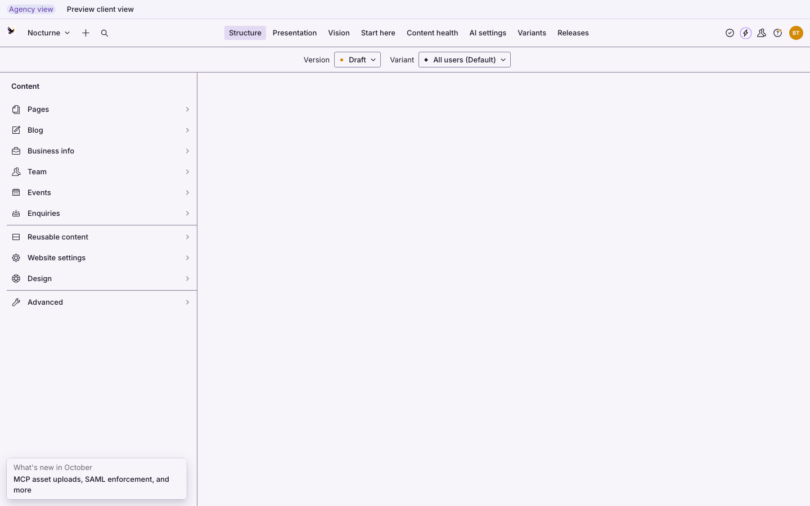          |
| Before, agency, dark, 1024                                                                                                      | 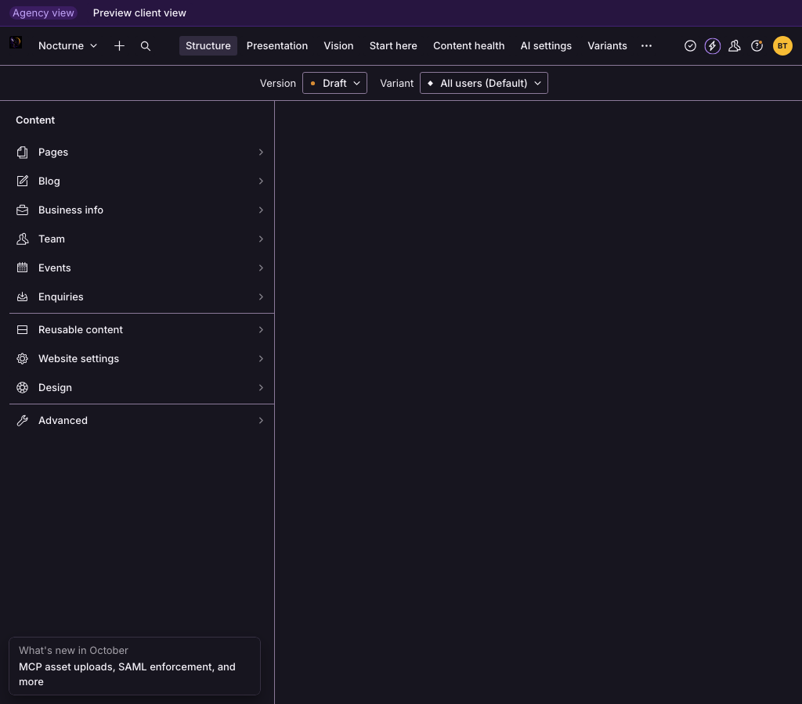      |
| After, agency, light, 1440: wordmark, one-row bar, expanded rail                                                                | 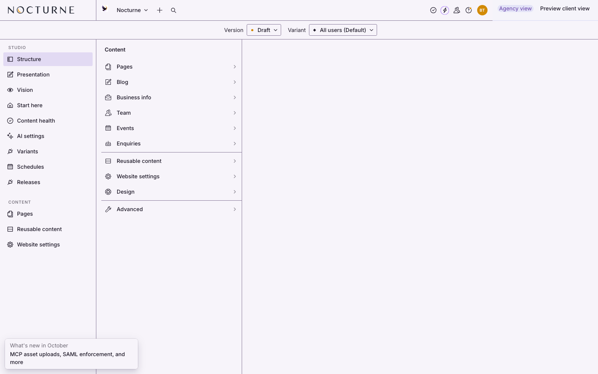            |
| After, agency, dark, 1440                                                                                                       | 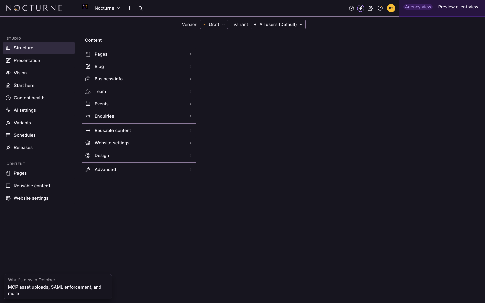        |
| After, agency, light, 1024: compact rail                                                                                        | 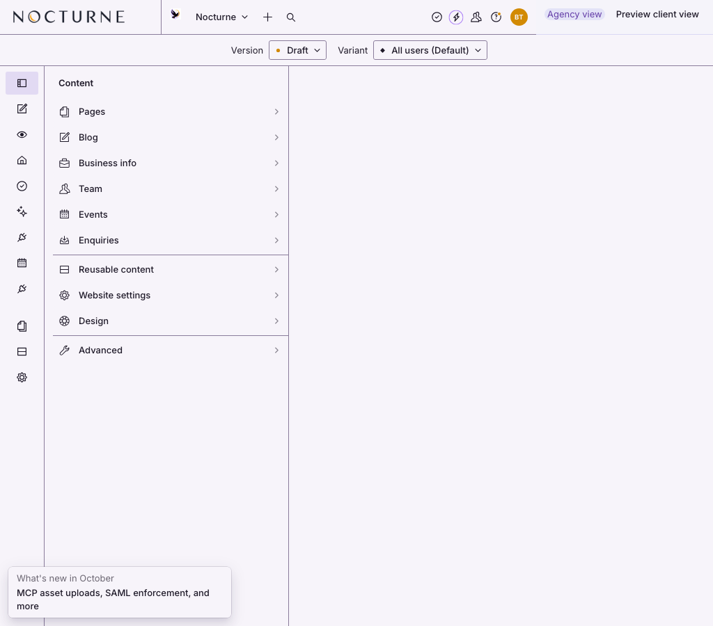            |
| After, agency, dark, 1024                                                                                                       | 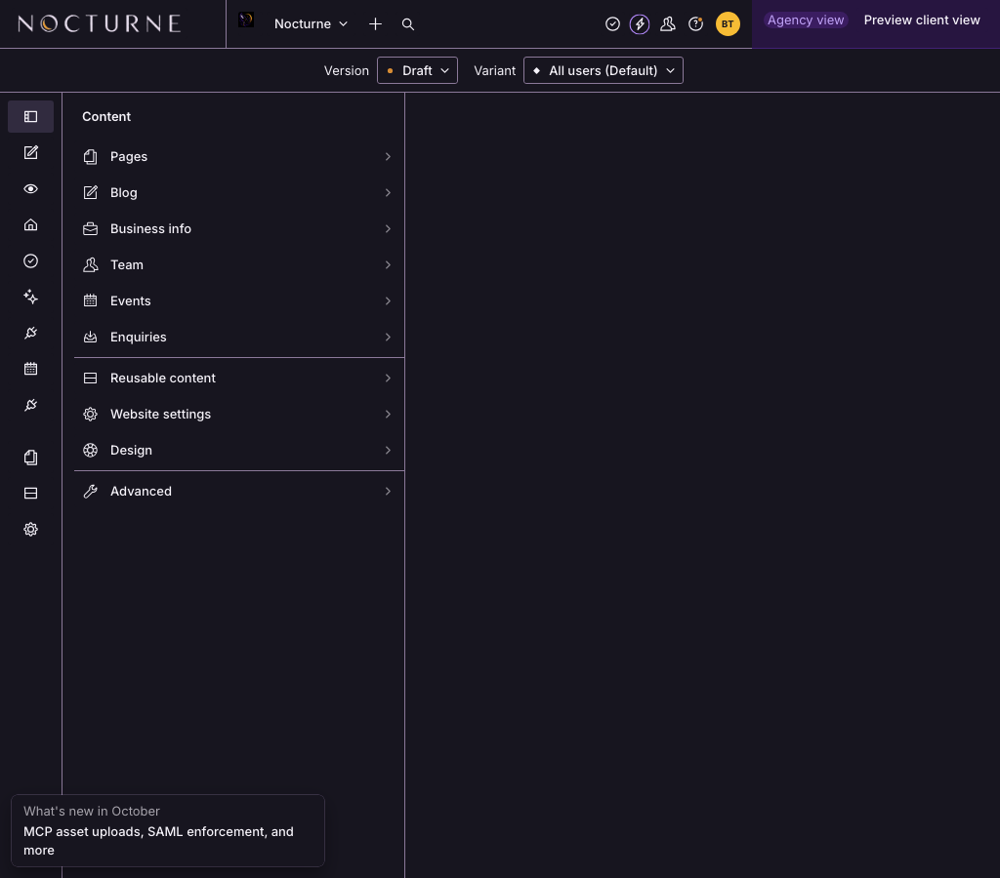        |
| After, agency, dark, 1024, Pages open: tool _selected_, content link _outlined_ (dev server; the round "N" is Next's dev badge) | 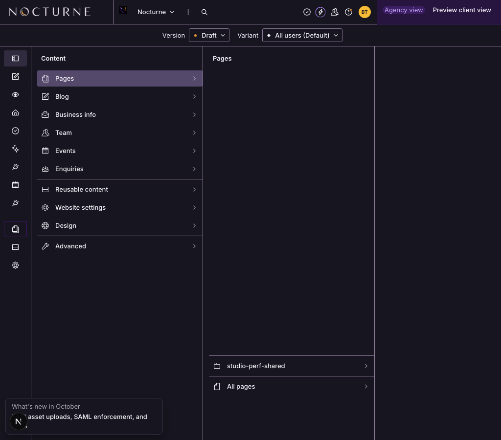 |
| After, agency, dark, 768: unchanged (strip + Sanity drawer)                                                                     | 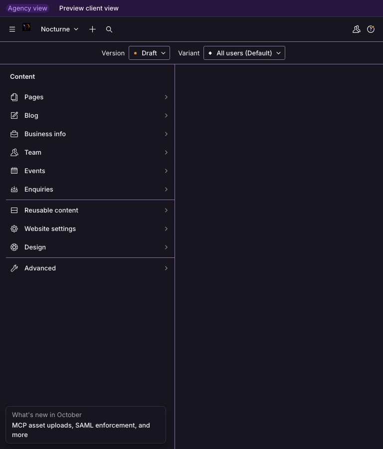               |
| After, agency, light, 390: unchanged                                                                                            | 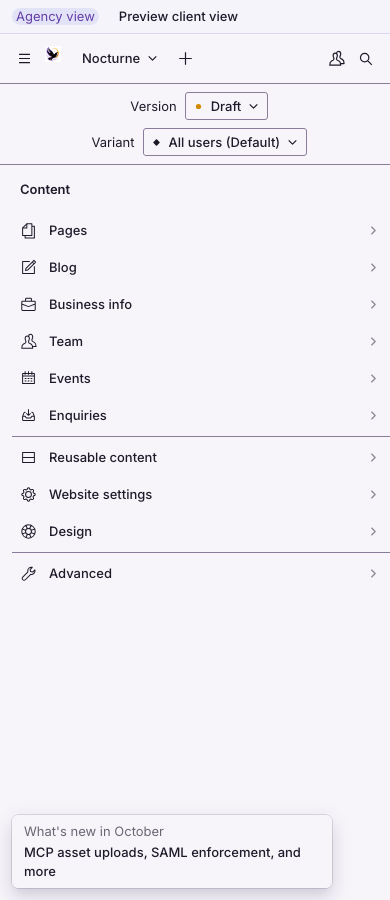              |
| After, client view, light, 1440: client tools only, "Back to agency" in the bar                                                 | 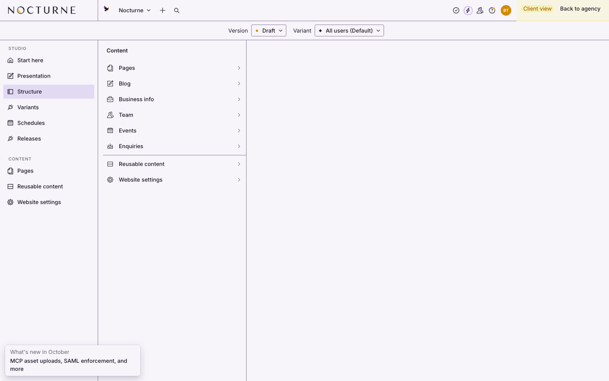           |
| After, client view, dark, 1024                                                                                                  | 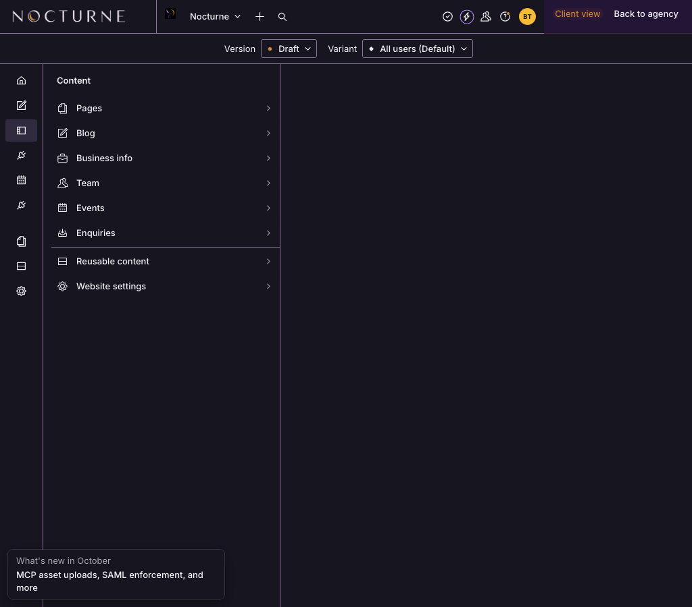            |
| After, client view, dark, 390: `RoleNavbar` strip still works                                                                   | 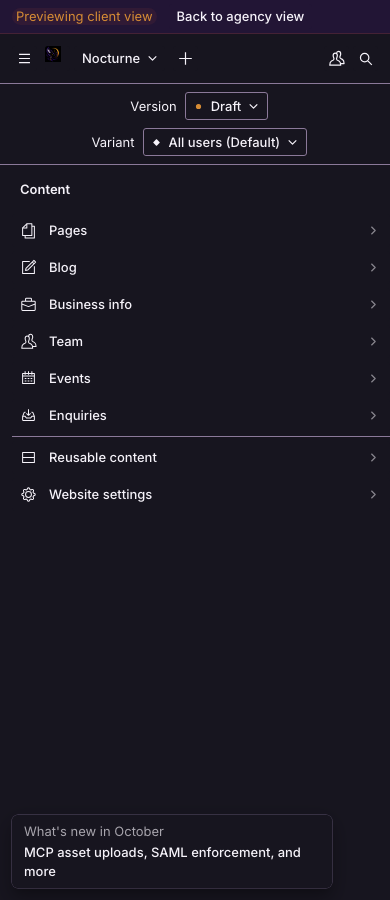              |

### Checks

- **Both roles.** Agency sees all nine tools; client view sees Start here, Presentation, Structure, Variants,
  Schedules and Releases (the existing `filterTools` order). Content links go through the existing
  `filterStructureItems`, so clients keep Pages, Reusable content and Website settings. Client view was set
  through the stored preview setting. The in-bar switch reuses `RoleNavbar`'s code (write the setting, reload)
  but **was not clicked** in this spike; task B's done-when covers it.
- **Keyboard order at 1440 px**, from the top of the document: Studio home (wordmark) → Sanity home → Nocturne
  workspace menu → Create new document → Open search → two icon buttons (this probe read no name from them) →
  Global presence → Help →
  account → **Preview client view** → Draft → All users → rail: Structure … Releases → Pages, Reusable content,
  Website settings → Collapse menu → Structure panes. This matches the visual order. At 390 px the order is
  today's, starting with the strip.
- **Focus after navigation.** Studio remounts the tool layout on each tool change. Without the hand-off, focus
  fell to `<body>` after choosing "Start here" (checked by turning the hand-off off). With it, focus returns to
  the link just used, with `aria-current="page"`, after Start here, Pages and Structure, at 1440 and 1024 px.
- **Widths.** 1440: expanded rail and one-row bar. 1024: compact rail; the bar has room because the tools left
  it. 768 and 390: Sanity's drawer and the strip, exactly as before.
- **Contrast and focus.** Every colour comes from the theme through Sanity UI tones, with nothing hard-coded.
  Focus rings are Sanity UI's. No new axe run: the Studio isn't covered by the e2e axe suite.
- `src/features/studio/no-ui-overrides.test.ts` passes on the branch (166 tests). The prototypes use no CSS, no
  `data-ui` selectors and no DOM queries.

### Studio download, before and after

The theme spike's method: cold load, local resources only, locally recompressed gzip (not wire bytes). Signed
out with every external request blocked; signed in opening `/studio/structure` with the throwaway project.

| Local resources                                           |    Before |     After | Difference |
| --------------------------------------------------------- | --------: | --------: | ---------: |
| JavaScript, signed out (56 files), gzip bytes             | 2,171,821 | 2,173,093 | **+1,272** |
| JavaScript, signed in on Structure (67 files), gzip bytes | 2,267,950 | 2,269,222 | **+1,272** |
| CSS (6 files), gzip bytes                                 |    44,320 |    44,320 |          0 |
| Fonts, WOFF2 bytes                                        |    48,432 |    48,432 |          0 |

The public site's JavaScript budget isn't affected: the shell code is imported only by `sanity.config.ts`.

## 4. Upgrade risk on a Sanity major

| Approach                                                      | What can break                                                                                                                                                                                                                                                                                                                                                                                                              | Risk                       |
| ------------------------------------------------------------- | --------------------------------------------------------------------------------------------------------------------------------------------------------------------------------------------------------------------------------------------------------------------------------------------------------------------------------------------------------------------------------------------------------------------------- | -------------------------- |
| Brand zone beside `renderDefault` in `navbar`                 | `NavbarProps` is beta. If Sanity moves the Version/Variant row out of the navbar, the zones become the bar's full height, which looks _better_. If Sanity adds its own wide logo slot, the zone becomes redundant. A failure is visible at once and limited to the bar.                                                                                                                                                     | **Low**                    |
| Agency controls in the bar                                    | As above. Sanity's right-hand controls can grow (they did for Releases and Variants). The bar already falls back to the strip below 900 px.                                                                                                                                                                                                                                                                                 | **Low**                    |
| `toolMenu` returning `null` in the top bar                    | If Sanity renames `context` or adds a third value, tools could show twice or not at all in the top bar. The drawer path is untouched.                                                                                                                                                                                                                                                                                       | Low–medium                 |
| Rail in `activeToolLayout`                                    | Beta. It renders inside the tool's scoped router, where `ToolLink` and `StateLink` **crash** ("Unable to find matching route for state: tool"), so the rail builds absolute URLs (`/studio/<tool>`, `/studio/structure/<id>`). Those depend on Studio's URL scheme and Structure item IDs. Focus restore depends on Studio remounting the layout per tool. Any change shows up as a broken link or lost focus, not a crash. | **Medium**                 |
| Structure `defaultPanes` for form + Preview                   | Public and documented; the view component is ours.                                                                                                                                                                                                                                                                                                                                                                          | Low                        |
| Page breadcrumb as a root `form.components.input`             | Beta, and already used here for inputs.                                                                                                                                                                                                                                                                                                                                                                                     | Low                        |
| Shell-wide breadcrumb from Structure's router state           | `panes` state shape is internal.                                                                                                                                                                                                                                                                                                                                                                                            | **High: don't build**      |
| Replacing `StudioNavbar` (for 60–64 px or the workspace card) | Rebuilds six unexported parts; every Sanity release that changes the navbar has to be followed by hand.                                                                                                                                                                                                                                                                                                                     | **Very high: don't build** |

## 5. Proposed build tasks

Sizes: S ≈ half a day, M ≈ 1–2 days, L ≈ 3–5 days.

**A. Show the CMS wordmark in the real Studio navbar (brand zone)** — S, P0 bug, build now.
What: replace the dead `studio.components.logo` with a fixed 232 px brand zone in the navbar from 900 px (the
`ShellNavbar` brand zone, without the rail). It holds the Nocturne wordmark, or the client logo when one is
set, as a named "Studio home" link. Drop `logo: StudioLogo` from the config and update the `StudioLogo` comment;
keep `StudioLogoView` for the brand preview.
Why: task 172's wordmark never renders in Sanity 6.19 (section 1). Supported API, +1.3 KB gzip.
Files: `src/features/studio/components/role-navbar.tsx` (or a new `brand-navbar.tsx`), `studio-logo.tsx`,
`sanity.config.ts`, README (CMS branding), CHANGELOG, plus a unit test for the breakpoint choice.
Done when: the wordmark shows in the real Studio at 900 px and up in both schemes, a client logo replaces it,
the bird mark stays below 900 px, and the e2e brand preview is unchanged.

**B. One-row top bar: agency controls inside the navbar** — S, P1, build with A.
What: from 900 px, put "Agency view" / "Client view" and its switch at the end of the bar; keep today's strip
below 900 px.
Why: 34 px more height for content on every screen, for both roles, and the concept's placement.
Files: `role-navbar.tsx`, README (Studio roles), CHANGELOG.
Done when: the switch works from the bar and the strip in both directions, and keyboard order is as in section 3.

**C. Form and Preview side by side in Structure** — M, P1, needs one decision.
What: `structureTool({ defaultDocumentNode })` gives pages and posts `S.view.form().id('editor')` and a
Preview view, opened with `.defaultPanes(['editor', 'preview'])`. Sanity's split view collapses Preview into
a tab when there isn't room. The Preview view loads the page through `/api/draft-mode/enable` the same way
Presentation does.
Why: VD-009's "adaptive two-column form and preview", fully supported, without sending editors to
Presentation.
Decision first: Presentation creates its draft-mode secret with `@sanity/preview-url-secret`, which is
installed only as a dependency of `sanity`. Using it means adding it to `package.json` (approval needed). The
alternative is linking to Presentation instead of embedding.
Files: `src/features/studio/structure.ts`, a new `src/features/studio/components/preview-view.tsx`,
`sanity.config.ts`, the route inventory test if any route changes, README, CHANGELOG.

**D. Studio rail** — M, P2, **deferred**; trigger: editor testing shows tool switching is a problem.
What: promote the spike's `ShellToolLayout`, `ShellToolMenu` and `shell-rail-state.ts` (compact choice, focus
hand-off). Drop the "Content" group, which duplicates Structure's root pane, unless testing shows editors use it
from other tools.
Why not now: the tools already fit in the top bar from 900 px, and the rail costs 64–232 px of pane width.
Files: `src/features/studio/components/shell/*`, `sanity.config.ts`, README, CHANGELOG, unit tests for the
state module.

**E. Page breadcrumb above a page's fields** — S, P2, optional.
What: a root `form.components.input` wrapper for `page` documents showing "Pages › services › web-design" from
the slug, each ancestor an `IntentLink` to that page.
Why: VD-009's scoped breadcrumb, in the one place a supported API reaches; nested objects already have
Sanity's own.
Files: `src/features/studio/components/page-breadcrumb.tsx`, `sanity.config.ts` (the `StudioInput`
composition), README.

## 6. Other findings

- **Sanity's home link has no accessible name.** The tab probe found no `aria-label`, text or title on it.
  It wraps our `StudioIcon`, which is decorative (`alt=""`). Screen readers announce an unnamed link at the start of every Studio page, before and
  after the spike. Task A's named "Studio home" link gives a named alternative. Fixing Sanity's own link would
  mean `StudioIcon` taking an `alt`, which would double the label in the workspace menu: worth a small test
  when doing A.
- **The bird mark looks like a dark square in the dark scheme** (before and after; see the 1024 dark
  screenshots). Check `bird-on-dark.webp`'s background in the brand assets.
- **Console warning, unrelated:** Structure warns "No apiVersion specified for document type list with custom
  filter" for the Upcoming and Past events lists (`src/features/studio/structure.ts`). Adding `.apiVersion()`
  to those two lists removes it.
- **Disk space:** the machine had 1.4 GB free during the spike, and Turbopack's dev cache hit "No space left on
  device" once. The spike's scratch builds have been deleted.

## Housekeeping

- `npm run check` on the spike branch: **passed** (276 files, 3,304 tests, plus types, lint and formatting).
- `npm run test:e2e` on the spike branch: 1,906 passed, 492 skipped, **8 failed**. All eight were
  `studio-brand-preview.spec.ts` timing out in `beforeEach` (30 s, waiting for the page to be ready); none
  asserted anything wrong. Reruns of that spec: spike 116/120 (four _different_ tests timed out), `main`
  120/120, spike again 120/120. The page imports nothing the spike changed. These are intermittent timeouts
  on a heavy page under load, worth a longer `beforeEach` timeout some time, not a spike regression.

- Visual baselines: no snapshot changed; the spike touches only the Studio, which the visual specs don't cover.
- The spike branch is not pushed. It shouldn't be merged; build tasks A–E from `main` instead.
